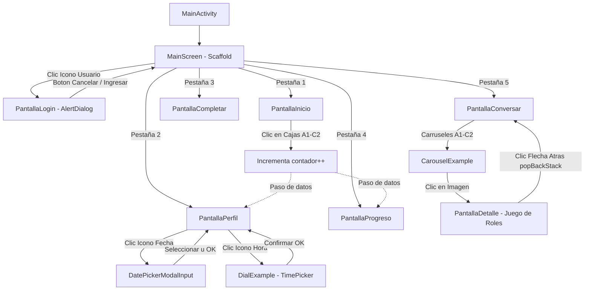

# 📄 MEMORIA DEL PROYECTO: APRENDE FÁCIL INGLÉS
**Módulo**: Programación Multimedia y Dispositivos Móviles (PMDM - DAM)  
**Proyecto**: Aplicación nativa Android para el aprendizaje del idioma inglés orientada al público hispanohablante  
**Tecnologías**: Kotlin, Jetpack Compose, Material Design 3, Navigation Compose (Type-Safe Routes)  

---

# 1. Descripción del funcionamiento

### 1.1 Explicación general de la aplicación
**Aprende Fácil Inglés** es una aplicación móvil nativa para Android desarrollada en **Kotlin** con **Jetpack Compose**. La aplicación está especialmente orientada al público de habla hispana que desea aprender y practicar el idioma inglés de forma intuitiva, estructurada y minimalista.

La app se concibe como un esqueleto interactivo robusto que abarca los niveles del marco común europeo (A1, A2, B1, B2, C1 y C2), combinando ejercicios de vocabulario, selección de metas de estudio y simulaciones de conversaciones reales mediante juegos de rol.

### 1.2 Flujo de navegación y estructura principal
La arquitectura de navegación está centralizada en un componente principal `MainScreen`, que gestiona una estructura visual basada en **Material Design 3**:

* **Barra Superior (`CenterAlignedTopAppBar`)**: Muestra el título de la aplicación (*"Aprende Inglés Rápido"*) y un icono de acceso rápido a la derecha (`AccountCircle`) para iniciar sesión.
* **Barra de Navegación Inferior (`NavigationBar`)**: Permite al usuario desplazarse libremente entre las 5 secciones principales de la app:
  1. **Inicio**: Panel principal de bienvenida y selección de niveles.
  2. **Perfil**: Formulario completo de personalización del estudiante.
  3. **Completar**: Sección de ejercicios interactivos de llenar espacios en blanco.
  4. **Progreso**: Pantalla de resumen de puntuación y logros acumulados.
  5. **Conversar**: Galería de carruseles de conversaciones por niveles.

### 1.3 Características e interacción en cada pantalla

1. **Pantalla de Inicio (`PantallaInicio.kt`)**:
   * Presenta un contador de puntos o lecciones acumuladas.
   * Dispone de 6 contenedores (`Box`) distribuidos en filas (`Row`) y columnas (`Column`) que representan los niveles **A1, A2, B1, B2, C1 y C2**.
   * **Comunicación entre componentes y actualización de puntos**: Al hacer clic en cualquiera de los niveles, `PantallaInicio` se comunica con la pantalla principal (`MainScreen`) notificando el clic. Esto incrementa la variable de puntos (`contador++`), la cual se transmite automáticamente como dato a las pantallas de **Perfil** y **Progreso**, manteniendo la puntuación actualizada en tiempo real en toda la app.

2. **Pantalla de Perfil (`PantallaPerfil.kt`)**:
   * Implementada con una lista eficiente **`LazyColumn`** para garantizar un scroll vertical fluido sin bloquear el renderizado.
   * Contiene un **formulario de preferencias de aprendizaje**:
     * *Campos de texto (`OutlinedTextField`)*: Alias del usuario y objetivo de aprendizaje.
     * *Diálogos emergentes*: Seleccionador de fecha objetivo (`DatePickerDialog`) y hora preferida de estudio (`TimePicker`).
     * *Radio Buttons*: Selección exclusiva del nivel de partida (A1, A2, B1, B2, C1, C2).
     * *Checkboxes*: Selección múltiple de áreas a reforzar (Vocabulario, Gramática, Conversación, Listening).
     * *Switches*: Activación de recordatorios de práctica y aceptación de términos y condiciones.
     * *Botón con validación y Toast*: Deshabilitado hasta aceptar términos; al pulsarlo muestra una alerta flotante de confirmación (*"¡Perfil guardado con éxito!"*).

3. **Pantalla de Completar Frases (`PantallaCompletar.kt`)**:
   * Diseñada para practicar la traducción y escritura.
   * Consta de una tarjeta en español, una tarjeta en inglés con la frase incompleta y una caja de entrada de texto (`OutlinedTextField`).
   * Incluye validación de respuesta mediante el botón *"Comprobar"* que lanza un `Toast` informativo (correcto/incorrecto) y un botón de avance *"Siguiente ejercicio ➔"* con control de paginación.

4. **Pantalla de Progreso (`PantallaProgreso.kt`)**:
   * Muestra la puntuación total de puntos acumulados recibida mediante argumentos de navegación desde la pantalla de Inicio.

5. **Pantalla de Conversar (`PantallaConversar.kt`)**:
   * Muestra 3 carruseles con scroll horizontal independiente (`HorizontalUncontainedCarousel`) divididos por niveles (A1-A2, B1-B2, C1-C2).
   * Cada tarjeta exhibe imágenes de alta calidad con títulos superpuestos y bordes redondeados (`maskClip`).

6. **Pantalla de Detalle de Conversación (`PantallaDetalle.kt`)**:
   * Se abre al hacer clic en cualquier imagen del carrusel.
   * Incluye una cabecera con botón de retroceso (icono de flecha `ArrowBack`) y el título *"Juego de roles"*.
   * Renderiza el diálogo en tarjetas estilo bocadillo de chat (`Card`), incluyendo botones interactivos de **Sonido 🔊** (reproducción simulada) y **Traducción 🌐** mediante mensajes `Toast`.

7. **Diálogo de Autenticación (`PantallaLogin.kt`)**:
   * Accesible desde el icono de usuario en la barra superior.
   * Despliega un cuadro de diálogo `AlertDialog` modal para introducir correo y contraseña con validación local y ocultamiento de clave (`PasswordVisualTransformation`).

---

# 2. Justificación del código y arquitectura

### 2.1 Elección de Jetpack Compose sobre el sistema clásico XML
Se ha utilizado **Jetpack Compose** porque es el toolkit declarativo moderno recomendado oficialmente por Google para el desarrollo de interfaces nativas en Android. La documentación oficial de Android indica que el sistema clásico de vistas XML se encuentra en proceso de obsolescencia (deprecation), por lo que Compose representa la tecnología presente y futura para crear interfaces de usuario de forma simple, directa y mantenible.

### 2.2 Eficiencia de Memoria: Arquitectura de Single Activity frente a múltiples Actividades
Siguiendo las buenas prácticas del módulo, la aplicación no utiliza múltiples actividades (`Activities`) ni fragmentos (`Fragments`):
* **Arquitectura de Única Actividad**: Toda la app se ejecuta sobre una **Single Activity (`MainActivity`)**.
* **Justificación de Memoria**: Las actividades tradicionales de Android son componentes muy pesados y poco eficientes en el consumo de memoria RAM. Al navegar exclusivamente entre funciones **`@Composable`** ligeras dentro de una sola actividad, se optimizan enormemente los recursos del dispositivo, agilizando las transiciones y simplificando el mantenimiento del código.

### 2.3 Comunicación y Paso de Datos entre Composables (State Hoisting y UDF)
Para que los componentes de la interfaz se comuniquen entre sí, se ha aplicado el patrón **State Hoisting** (Elevación de Estado) y el Flujo Unidireccional de Datos (UDF):
* **Comunicación entre funciones `@Composable`**: Las pantallas hijas (como `PantallaInicio`) no guardan variables de estado globales de forma aislada. En su lugar, se comunican notificando eventos hacia el componente principal (`MainScreen`).
* **Paso de Datos**: `MainScreen` actúa como fuente de verdad y pasa los datos actualizados (como el `contador` de puntos) hacia las demás pantallas (`PantallaPerfil` y `PantallaProgreso`), permitiendo que todos los composables compartan y muestren la misma información en tiempo real.

### 2.4 Navegación Declarativa con Navigation Compose
La biblioteca **Navigation Compose** permite gestionar el flujo de la aplicación de manera nativa sin necesidad de XML ni transiciones pesadas:
* **Rutas Tipadas Seguras (`@Serializable`)**: Se han definido las rutas mediante objetos y clases de datos Kotlin:
  ```kotlin
  @Serializable object Inicio
  @Serializable data class Perfil(val contador: Int)
  @Serializable data class DetalleConversacion(val id: Int)
  ```
* **Justificación**: Permite navegar entre funciones `@Composable` garantizando que los parámetros pasados (como el ID de una conversación o los puntos acumulados) se verifiquen en **tiempo de compilación**, eliminando errores por cadenas de texto mal escritas y evitando cierres inesperados de la app.

### 2.5 Selección de Contenedores de UI de Material Design 3

1. **`Scaffold`**: Utilizado en `MainScreen` para estructurar de forma limpia la barra superior (`CenterAlignedTopAppBar`), la barra inferior (`NavigationBar`) y el botón flotante (`FloatingActionButton`).
2. **`LazyColumn` en `PantallaPerfil.kt`**: 
   * *Justificación*: Para el formulario extenso de perfil (campos de texto, fecha, hora, radio buttons, checkboxes y switches), se eligió la lista eficiente `LazyColumn`. A diferencia de un contenedor tradicional, recicla los elementos visibles en pantalla, garantizando un scroll fluido y evitando bloqueos de rendimiento.
3. **`HorizontalUncontainedCarousel` en `CarouselExample.kt`**:
   * *Justificación*: Componente visual moderno de Material 3 elegido para permitir el desplazamiento horizontal independiente de las tarjetas de diálogo por niveles.
4. **`Card` y `Surface`**: Utilizados para agrupar bloques de contenido (como los bocadillos de diálogo en `PantallaDetalle` o las preguntas en `PantallaCompletar`), manteniendo una jerarquía visual clara.

### 2.6 Gestión de Dependencias (Gradle Version Catalog)
Se centralizó la configuración de librerías en **`gradle/libs.versions.toml`**:
* **Justificación**: Mantiene en un único lugar las versiones de plugins y dependencias (Kotlin 2.4.x, Compose BOM, Navigation 2.10.x, Kotlinx Serialization), asegurando la compatibilidad del proyecto.

---

# 3. Estructura de pantallas con diagramas

### 3.1 Diagrama del flujo de navegación (Mermaid)



### 3.2 Descripción detallada del flujo entre pantallas

1. **Pantalla Raíz (`MainActivity` & `MainScreen`)**:
   * Al iniciar la app, `MainActivity` carga el tema de la aplicación y ejecuta `MainScreen()`.
   * `MainScreen` establece el contenedor `Scaffold` con la barra superior de título y la barra inferior de navegación de 5 pestañas.
   * La pantalla de inicio predeterminada (`startDestination`) es `PantallaInicio`.

2. **Acceso al Login Modal (`PantallaLogin.kt`)**:
   * Desde cualquier pantalla, el usuario puede pulsar el icono de cuenta (`AccountCircle`) situado en la esquina superior derecha de la barra superior.
   * Esto despliega el diálogo modal `PantallaLogin`. Al pulsar *"Cancelar"* o hacer un inicio de sesión correcto, el diálogo se cierra regresando a la pantalla donde estaba el usuario.

3. **Navegación por Pestañas Inferiores (`NavigationBar`)**:
   * El usuario puede alternar libremente entre las 5 pestañas principales sin perder el estado de la aplicación:
     * **Inicio**: Contiene las tarjetas de niveles (A1 a C2). Cada clic en un nivel notifica a `MainScreen` para sumar puntos (`contador++`).
     * **Perfil**: Muestra el formulario completo en `LazyColumn`. Al pulsar en las cajas de fecha o hora, se abren los diálogos modales nativos (`DatePickerDialog` y `TimePicker`) para seleccionar los valores.
     * **Completar**: Presenta la secuencia de tarjetas de ejercicios de traducción. El usuario completa el campo de texto, comprueba la respuesta con un `Toast` y avanza a la siguiente pregunta con *"Siguiente ejercicio ➔"*.
     * **Progreso**: Recibe la variable `contador` transmitida desde `MainScreen` y dibuja el total de puntos acumulados hasta el momento.
     * **Conversar**: Renderiza los 3 carruseles de situaciones por niveles con desplazamiento horizontal.

4. **Flujo de Pantalla Secundaria (`PantallaDetalle.kt`)**:
   * Al hacer clic en cualquier imagen de los carruseles de `PantallaConversar`, la app realiza un salto de navegación seguro (`navController.navigate(DetalleConversacion(id))`) hacia `PantallaDetalle`.
   * En `PantallaDetalle`, el usuario practica el *Juego de Roles* interactuando con los botones de audio 🔊 y traducción 🌐.
   * Al hacer clic en el icono de la **flecha de atrás** (situado en la cabecera debajo de la barra superior), se ejecuta `navController.popBackStack()`, devolviendo al usuario exactamente a la pantalla de carruseles `PantallaConversar`.

---

# 4. Aspectos a destacar, componentes personalizados y retos superados

### 4.1 Reto Principal: Simulación de funcionalidades avanzadas sin BBDD, APIs ni llaves de IA
Uno de los mayores desafíos del proyecto fue diseñar un esqueleto y prototipo plenamente funcional e interactivo **sin poder utilizar bases de datos, APIs de traducción/audio ni claves de API de modelos de Inteligencia Artificial (LLM)**. 

* **Estrategia aplicada**: Se diseñó una arquitectura basada en **hardcodeo inteligente de datos y gestión estricta de estados** en Jetpack Compose.
* **Resultado**: Se logró simular con gran realismo un sistema completo de aprendizaje (juegos de rol, respuestas de audio, traducciones instantáneas, ejercicios de completar frases y acumulación de puntos en tiempo real), ofreciendo una experiencia de usuario fluida y verosímil sin depender de servidores externos.

### 4.2 Componente Personalizado Reutilizable: `CarouselExample.kt`
Para evitar la duplicación de código y garantizar la mantenibilidad, se diseñó un **componente plantilla personalizado** (`CarouselExample`):
* **Reutilización de código**: El componente acepta como parámetros el título del nivel y una lista parametrizada de objetos `CarouselItem` (ID, recurso de imagen `imageResId`, descripción y título).
* **Flexibilidad**: Gracias a esta plantilla, en `PantallaConversar.kt` se pudieron instanciar de forma limpia y elegante **3 carruseles horizontales independientes** (Niveles A1-A2, B1-B2 y C1-C2) utilizando imágenes de alta resolución (`carrusel1` a `carrusel5`) con bordes redondeados (`maskClip`) y degradados de contraste para el texto.

### 4.3 Pantalla Secundaria de Juego de Roles (`PantallaDetalle.kt`)
Ante la imposibilidad de conectar una API de IA en tiempo real para generar diálogos por voz, se creó la pantalla secundaria **`PantallaDetalle.kt`**:
* **Simulación de Roleplay**: Organiza la conversación en bocadillos de chat (`Card`) alternando el color del contenedor según el hablante (diferenciando el turno de la app del turno del estudiante).
* **Interactividad avanzada**: Cada bocadillo incluye dos botones interactivos:
  * 🔊 **Icono de Sonido**: Lanza un mensaje `Toast` simulando la reproducción de audio nativo.
  * 🌐 **Icono de Traductor**: Despliega un mensaje `Toast` con la traducción al español de la frase seleccionada.

### 4.4 Retos Técnicos de Rendimiento y Navegación Resueltos

1. **Optimización del Scroll en Formularios (`LazyColumn`)**:
   * *Problema*: Al construir el formulario de perfil con un contenedor `Column` tradicional y `.verticalScroll()`, la presencia de múltiples componentes interactivos (text fields, radio buttons, checkboxes, switches) generaba bloqueos de medición y congelamientos en la UI.
   * *Solución*: Se migró la estructura a una lista eficiente **`LazyColumn`**, aislando cada sección en bloques `item { ... }`. Esto eliminó el congelamiento y proporcionó un deslizamiento vertical fluido en cualquier dispositivo.

2. **Estabilidad en la Pila de Navegación (*BackStack*)**:
   * *Problema*: Al transitar entre pantallas que reciben argumentos (como `Perfil(contador)` o `DetalleConversacion(id)`), la navegación por pestañas inferiores se bloqueaba por conflictos al intentar restaurar estados en rutas tipadas con parámetros.
   * *Solución*: Se reestructuraron las opciones de navegación en `MainScreen.kt` utilizando de forma limpia `popUpTo<Inicio>()` y `launchSingleTop = true`, garantizando que la app navegue siempre de forma instantánea y sin bloqueos.

### 4.5 Conclusión del Proyecto
El proyecto **Aprende Fácil Inglés** demuestra cómo, aplicando los principios fundamentales de Jetpack Compose, componentes de Material Design 3 y buenas prácticas de arquitectura (Single Activity, State Hoisting y rutas tipadas), es posible construir una aplicación móvil atractiva, eficiente y altamente funcional lista para escalar en el futuro.
